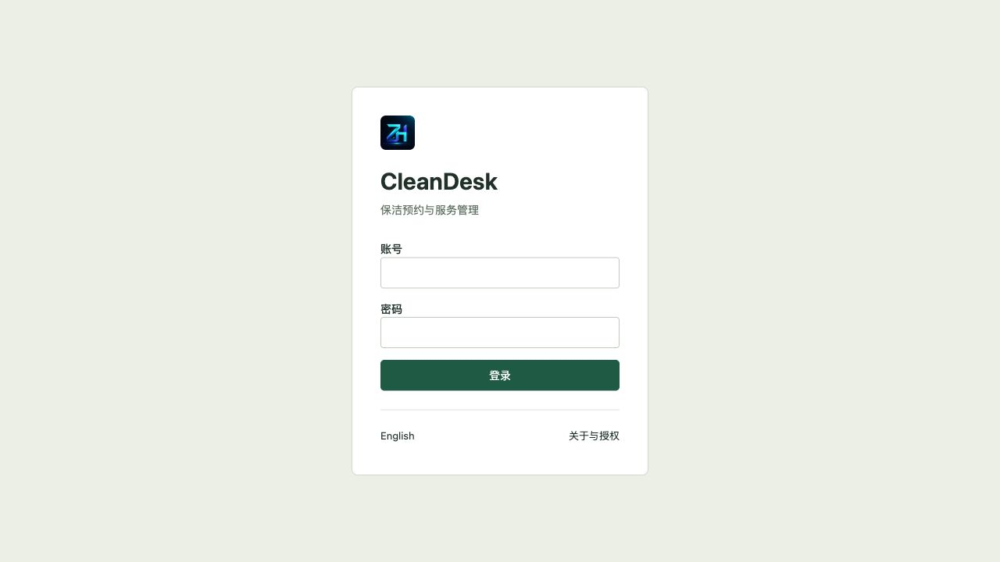
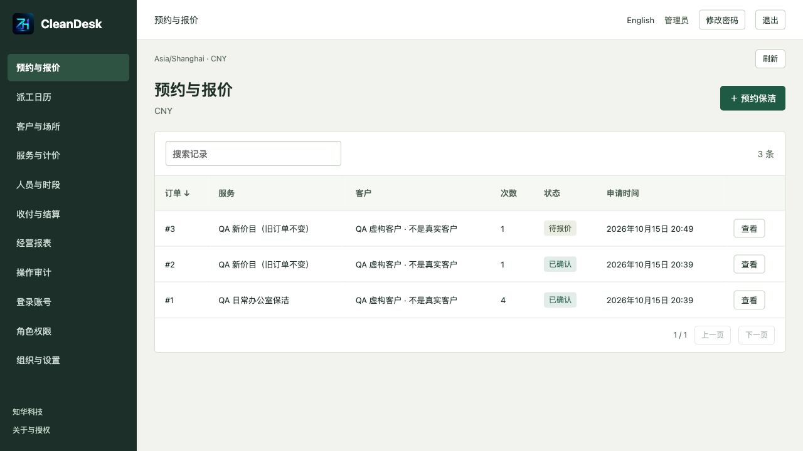
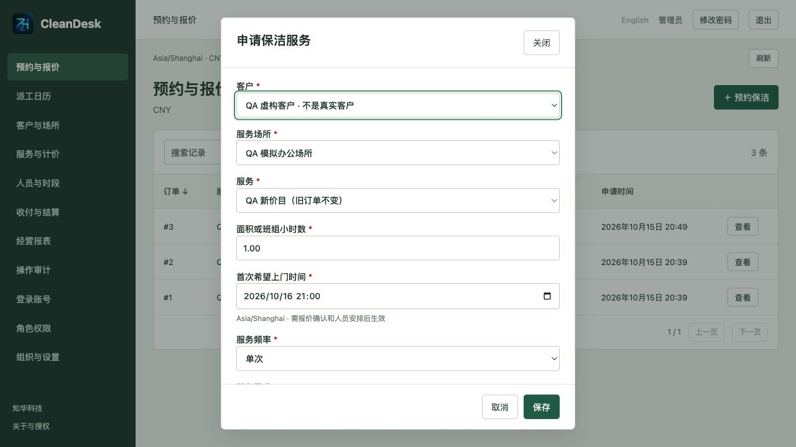
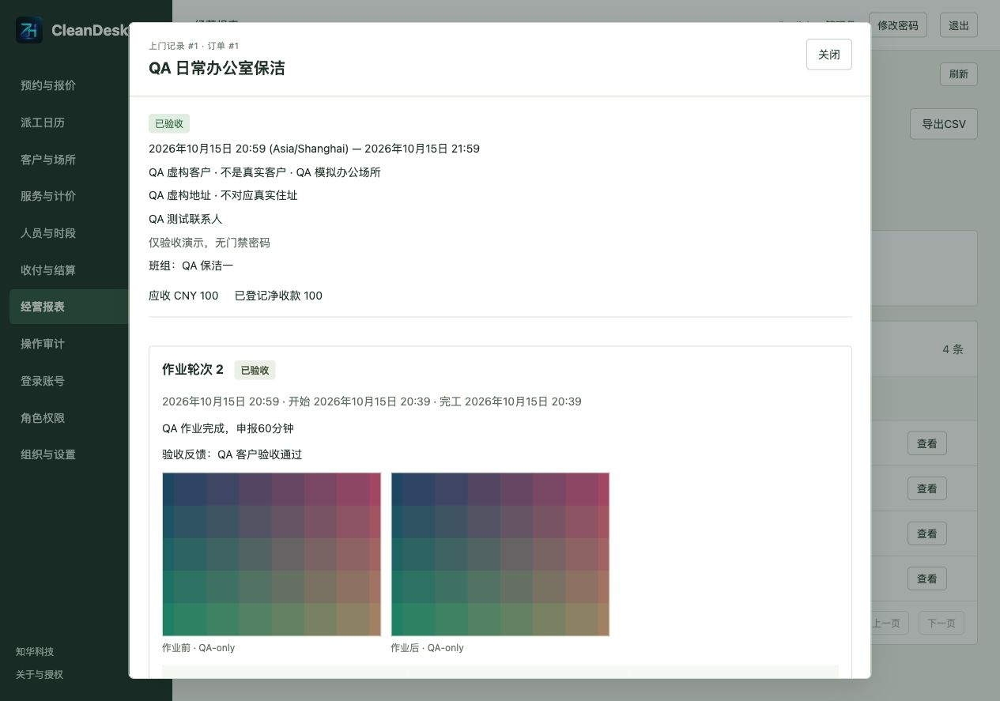
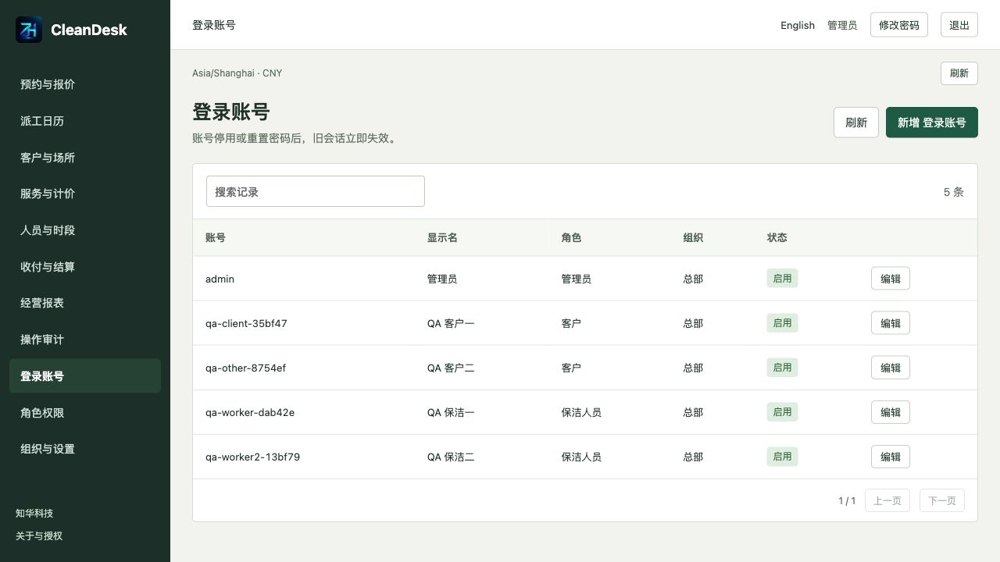
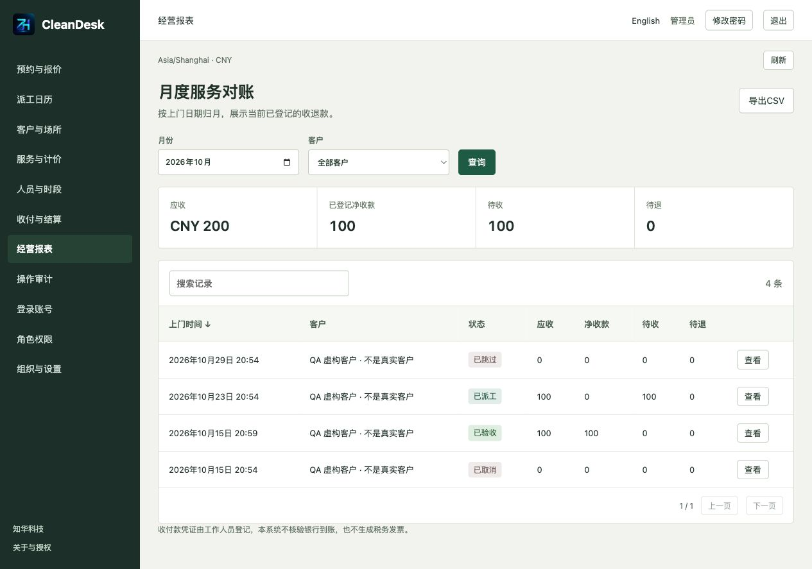
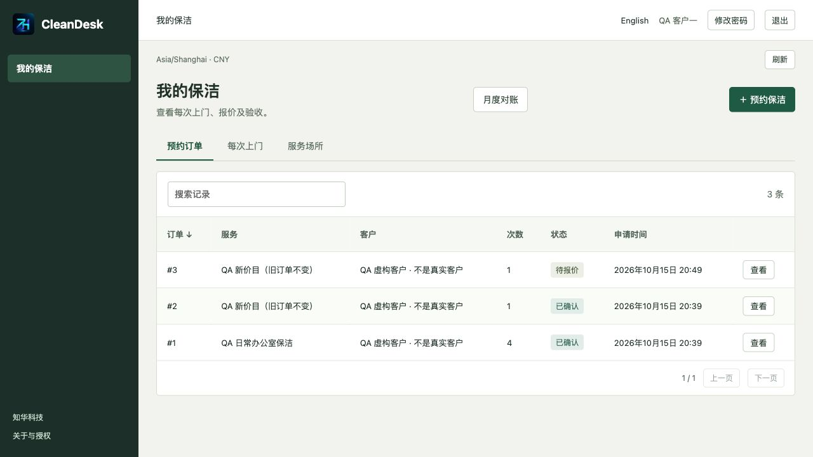
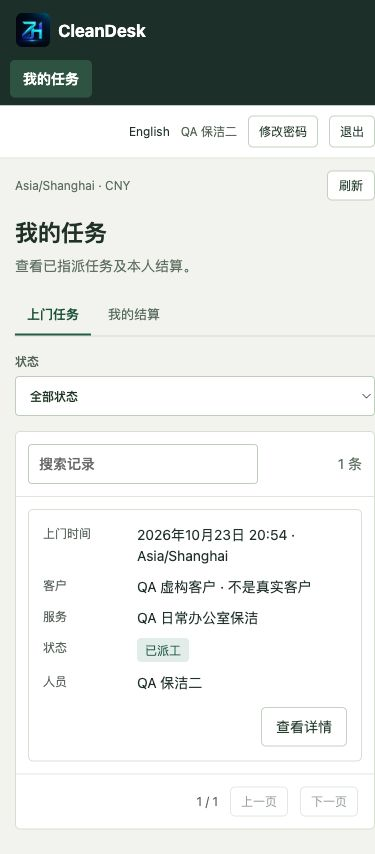

[中文](README.md) | [English](README.en.md)

# 知华 CleanDesk · 保洁预约、周期派工与人员结算系统

**知华科技（上海如静知华信息科技有限公司）** · [官方网站](https://www.zhuatech.cn/)

CleanDesk 面向独立保洁公司，连接客户、办公室和保洁人员：从场所与价目、周期预约、报价确认、按次派工，到作业照片、返工验收、收退款登记和人员结算。Java 21 / Spring Boot / Vue 3 / MySQL 8，提供中文和英文界面。

**公开源码学习版／非商业源码版**，仅限个人学习交流。未经上海如静知华信息科技有限公司授权不得商用。源码可读不等于允许免费商用，详见 [LICENSE](LICENSE)。

## 适用场景

- 家庭日常保洁：每周或隔周上门，单次改期或跳过，保留其他次数。
- 小型办公室保洁：按面积、班组小时或每次报价，按上门月份查询对账。
- 多人班组：检查每位人员的工作时段、请假及交通间隔；指定当次负责人。
- 服务质量处理：前后照片、客户验收和免费返工，原作业及成本继续保留。

这是单家公司内部业务系统，支持组织数据范围；不是公开接单撮合平台。客户和员工账号由办公室建立并绑定。

## 已实现功能

| 入口 | 业务能力 |
| --- | --- |
| 客户端 | 本人场所、一次或每周/隔周预约（最多12次）、查看与确认报价、提前改期/取消/跳过、查看照片、验收/返工、月账单与CSV |
| 员工端 | 本人派工、受保护照片、负责人开工/完工、逐人工时申报、查看并确认本人结算单；适配手机浏览器 |
| 办公室 | 客户/场所、分类字典、服务/增项、人员/工作时段/请假、报价与线下确认凭证、派工替班、收退款与结算登记、月报与审计 |
| 系统管理 | 登录账号、重置密码、启停账号、角色与组织范围、菜单、字典和参数；本人修改密码后旧会话失效 |

报价固化名称、地址、价格、增项、班组时长和人数。每次上门有稳定标识，改期不生成重复订单。重复命令受服务端幂等约束；中断后可核对结果，明确操作后才原样重发。

## 实际运行页面

以下均为当前程序的实际运行截图，使用明确标注的虚构 QA 资料；色块是测试图片，不是真实客户作业照片。

| 页面 | 功能 |
| --- | --- |
|  | 会话登录，无固定公开密码 |
|  | 按订单查看周期服务和报价状态 |
|  | 客户、场所、服务与频次联动 |
|  | 作业轮次、前后照片和验收历史 |
|  | 账号、角色及启用状态 |
|  | 已确认服务的应收、净收款、待收与待退 |
|  | 客户本人预约和月度对账入口 |
|  | 手机查看本人任务和结算 |

## 技术架构与目录

同源浏览器 → Nginx → Spring Boot → MySQL。照片验证后重编码为 PNG，元数据和二进制一起写数据库事务，无公开图片地址。Flyway 管理结构版本，Hibernate 仅校验结构。

```text
backend/              Java 业务、权限、迁移及测试
frontend/             Vue 三端界面、真实品牌图片
scripts/              初始化、健康检查、HTTP验收、备份恢复
compose.yaml          MySQL、后端、前端
compose.test.yaml     独立 MySQL 测试环境
docs/                业务、架构、API、操作、安全、部署及截图
```

业务表与状态见 [架构与数据](docs/ARCHITECTURE.md)，接口见 [API](docs/API.md)，第三方许可见 [第三方依赖](docs/THIRD_PARTY.md)。

## 环境要求与安装启动

- 首次构建需能访问 Maven、npm 与 Docker 官方镜像仓库；业务运行不依赖第三方支付、通知或地图服务。
- Docker Engine 与 Docker Compose v2；默认仅绑定 `127.0.0.1:8174`。
- 源码开发：Java **21**、Maven **3.9+**、Node.js **24.19.0+**、npm；MySQL **8.4**。
- 固定依赖：Spring Boot **4.0.7**、Vue **3.5.43**、Vite **8.1.5**。建议为独立本地环境预留4GB内存和足够镜像/数据库空间；尚无压力测试容量承诺。

```bash
python3 scripts/init-env.py
docker compose -p cleandesk-local config --quiet
docker compose -p cleandesk-local up --build -d --wait --wait-timeout 3600
python3 scripts/readiness.py --base http://127.0.0.1:8174
```

打开 <http://127.0.0.1:8174>。初始化脚本只创建不存在的私有 `.env`，权限0600；登录账号与密码分别读取其中的 `ADMIN_USERNAME`、`ADMIN_PASSWORD`。不要公开该文件或截图中的密码，不要将 `.env.example` 当成真实密码使用。

### 数据库初始化

首次启动空 `mysql-data` 卷，MySQL创建应用库，Flyway执行 `V1__identity.sql`、`V2__cleaning.sql`；初始化组织、角色、权限、菜单和类别以及一个管理员。**不内置客户、员工、预约或收付款。** 不需要手工执行SQL，不要修改已应用迁移；新增结构应追加新版本。

已有卷不会因修改 `.env` 自动更改数据库密码或管理员密码。管理员可在登录账号中重置其他账号密码，本人从页头修改。保留至少一位完整管理员。

### 配置说明

| 配置 | 用途 |
| --- | --- |
| `ADMIN_USERNAME` / `ADMIN_PASSWORD` | 仅首次创建管理员使用；强密码12–72字节，含大小写字母和数字 |
| `DATABASE_PASSWORD` / `MYSQL_ROOT_PASSWORD` | 应用数据库及数据库root口令，不提交版本库 |
| `BIND_ADDRESS` / `WEB_PORT` | 前端本机绑定地址及端口；默认127.0.0.1 / 8174 |
| `COOKIE_SECURE` | 本地HTTP为false；HTTPS部署须true |
| `TEST_DATABASE_PASSWORD` / `TEST_ROOT_PASSWORD` | 独立测试库凭据，不能指向客户数据库 |

直接运行后端还需 `DATABASE_URL`、`DATABASE_USER`、`DATABASE_PASSWORD`；Compose已设置内部连接，不暴露MySQL端口。组织时区使用 IANA 名称，初始 `Asia/Shanghai`。已有业务或人员后锁定组织时区，已有预约后锁定币种。系统参数包含客户取消提前小时数（默认24）、人员交通间隔（默认30分钟）、单币种代码（默认CNY）。

### 源码开发

先准备独立MySQL并设置私有环境变量，再启动后端：

```bash
cd backend
mvn spring-boot:run
```

另一个终端启动前端；开发代理默认后端 `127.0.0.1:8080`：

```bash
cd frontend
npm ci
npm run dev
```

需要不同后端时设置 `CLEANDESK_API_TARGET=http://127.0.0.1:8080`。开发服务器只绑定本机。

## 第一次使用

1. 管理员维护组织、角色、服务分类和参数；建立客户与员工登录账号。
2. 建立客户，绑定专用客户账号；建立服务场所。没有线上账号的客户可由办公室记录线下凭证。
3. 维护服务与增项、人员结算单价；绑定员工账号并建立每周工作时段，按需登记请假。
4. 客户申请服务，办公室报价，客户确认；办公室安排满足时段和人数要求的班组。
5. 当轮负责人上传作业前照片、开始作业，上传作业后照片、登记各人工时并提交完工。
6. 客户验收或要求返工；财务登记外部收退款。结算单在人员本人确认后登记外部付款。

详细步骤、取消限制与异常处理见 [操作手册](docs/OPERATIONS.md)。

## 测试与质量检查

```bash
cd backend
mvn spotless:check verify
```

```bash
cd frontend
npm ci
npm run format:check
npm run lint
npm test
npm run build
```

```bash
docker compose -p cleandesk-local config --quiet
python3 -m compileall -q scripts
python3 -m unittest discover -s scripts -p 'test_*.py'
python3 scripts/release-check.py
```

后端覆盖计价精度、夏令时、周期标识、快照、幂等、并发派工、权限撤销、照片授权、取消退款、返工与结算。默认使用H2；真实MySQL测试使用独立环境：

```bash
docker volume create cleandesk-maven-cache
docker compose --env-file .env -p cleandesk-tests -f compose.test.yaml up -d --wait mysql
docker compose --env-file .env -p cleandesk-tests -f compose.test.yaml run --rm tests
docker compose --env-file .env -p cleandesk-tests -f compose.test.yaml down -v
```

`quality.py` 会在**专用、空白验收库**创建虚构账号与业务，并走真实HTTP三端流程。不可在客户环境运行；脚本在深夜将已确认空白的验收组织切换为UTC以避开跨日排班，并将一次性账号资料保存为私有0600文件：

```bash
python3 scripts/quality.py --base http://127.0.0.1:8174 --isolated-test-database
python3 scripts/verify-persistence.py --base http://127.0.0.1:8174 --state output/qa-state.json
```

## 部署与备份

使用反向代理提供HTTPS，设置 `COOKIE_SECURE=true`。仅开放必要Web入口，不公开数据库、管理口令或照片备份。先在隔离环境演练初始化、重启与恢复，再接入业务。镜像构建会执行测试，不跳过Maven测试。

```bash
python3 scripts/backup.py --project cleandesk-local --output /private/backup/cleandesk.zip
python3 scripts/restore-env.py --source .env --output output/restore.env --port 8176
python3 scripts/restore.py /private/backup/cleandesk.zip --project cleandesk-restore --env-file output/restore.env
```

备份期间仅暂停所选项目后端写入，结束后恢复。照片BLOB包含在SQL里；归档含客户地址、照片与口令哈希，必须私有保管。恢复只接受可信备份、独立本机端口、尚不存在的目标容器和卷。校验和用于发现损坏，不证明来源可信。详见 [部署手册](docs/DEPLOYMENT.md) 与 [安全说明](docs/SECURITY.md)。

## 已知限制

- 没有支付网关、银行卡扣款、税务发票、短信/邮件/WhatsApp通知、地图路线优化、GPS或原生App；收款、退款和人员付款都是**已完成外部交易的人工凭证登记**。
- 申请时不承诺人员余位，报价确认后仍须派工；周期为固定最多12次，不自动无限续约。单次班组时长30–720分钟，只支持同一当地日内排班。
- 工时由负责人逐人申报，照片不代表定位/时间真实性认证；无离线写入。客户和员工账号不提供公开注册、OTP或忘记密码邮件。
- 已开工作业须完工或返工验收，不提供中途终止退款、争议仲裁或部分服务减免；停用账号的未完任务须由管理员恢复账号后处理。
- 取消已完成返工的服务不按“未服务”处理。客户取消与改期须满足提前时间；办公室例外操作留原因，线下确认/验收须留凭证。
- 单安装单币种；月账单仅包含已确认订单，按每次上门日期归月并反映当前凭证，不等于银行流水、现金期间账或财务总账。
- 业务写入使用统一数据库行锁，列表最多10000条，照片单张8MB、单轮12张、单组织256MB；适用于学习及小规模评估，未验证高并发、多实例或大规模容量。
- 没有声称已获真实客户使用、付款或生产安全认证。正式商用须授权并按具体业务做容量、安全、隐私和部署验收。

## 授权与第三方声明

自有代码仅限个人学习交流，未经上海如静知华信息科技有限公司授权不得商用，不提供MIT/Apache等免费商用授权。详见 [LICENSE](LICENSE)。第三方依赖依其各自许可证使用，保留原有版权；不能把第三方依赖的许可扩大解释为本项目自有业务源码的许可。

## 联系知华科技

商业授权或深度定制开发请联系知华科技。服务包括源码授权、定制开发、私有部署与系统集成。

- 官网：<https://www.zhuatech.cn/>
- 微信：`zhuatech`、`zhuatech2`

<table>
<tr><td align="center" valign="middle"></td><td align="center" valign="middle"></td></tr>
<tr><td align="center">微信 zhuatech</td><td align="center">微信 zhuatech2</td></tr>
</table>
